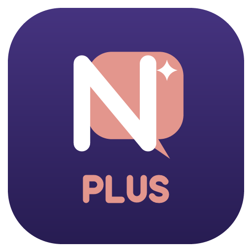

<div align="center">



# Najwa AI Plus

<sub>Najwa AI with a full agent harness · by Bandar Altariqi</sub>

### Your private AI, plus an agent that works in your projects, safely.

**[Download](#download)** · **[What Plus adds](#what-plus-adds)** · **[Get started](#get-started)** · **[Najwa AI](https://github.com/bandar9994/najwa-ai)** · **[License](#license)**

</div>

Najwa AI Plus is [Najwa AI](https://github.com/bandar9994/najwa-ai) (private chat that remembers you, on every device, with any model) **plus an agent**. Give a chat a project folder and its replies work there: they read and search your files, change them and run commands, step by step, as you allow. Your phone becomes its remote control.

It's a separate app: it installs **beside** Najwa AI, with its own data, and never replaces it.

## What Plus adds

**An agent in a project folder.** In any chat, tap **📁 Project** at the top and pick a folder. The agent can list, read, find and search files; edit or write them (with a coloured diff on every change); run commands, or keep a dev server running in the background; keep a to-do list you watch fill in; and use Git (status, diff, history, and commits you approve). It reads the project's instructions from `NAJWA.md`, `AGENTS.md` or `CLAUDE.md`.

**You stay in charge.**
- **Four modes per chat:** *Ask first* (every change and command), *Auto-edit* (changes files, asks before commands), *Plan only* (reads and plans, changes nothing) and *Auto* (does it all, but commands that could do harm always ask).
- **Rules:** "always allow `npm test`" and the like.
- **Undo:** every change is kept: ⋯ → *Undo the agent's last change*, one change at a time.
- **Replay:** every run is kept as a timeline you can play back, or save as a web page to share (with secrets hidden).

**Only in Plus**
- 📱 **Agent in your pocket:** the agent runs on your computer; your phone shows each step, diff and question live. Approve or deny from anywhere (even from the notification), and send it messages while it works.
- 🛡️ **Privacy firewall:** API keys, tokens, passwords and `.env` values are hidden from cloud models (`«secret-1»`), and still kept where they belong. Folders you mark private are only read by models on your own computer or network. A 🛡️ line shows what went to which model.
- 🧑‍⚖️ **Second opinion:** another model checks each change and command before you're asked, and the card shows its verdict and the risks.
- 🧪 **Dry run:** a command that would change files runs first in a throwaway copy; you see exactly what it would change, then apply it or throw it away.
- 🏠 **Homelab:** the agent works on your own machines over SSH (Tailscale names work), with a permission per machine: look only, ask, or auto. Risky commands always ask.
- 👥 **Mixed crew:** a big model plans and checks, small or local models search and do the work. **Local only** keeps everything on your computer and network.
- ⏪ **Rewind from anywhere:** the agent's changes are kept and synced encrypted with the chat, so you can undo them from your phone or another computer.
- 🎙️ **Voice and Arabic:** talk to it (Whisper, on your computer); it reads back its questions and finished steps in Arabic or English, and diffs read correctly right to left.
- 💰 **Budget guard:** each task shows its tokens and cost as it works (with the prices you enter per provider), and stops to ask at your spending cap.

**Also:** slash commands (`/review`, `/init`, and your own in `.najwa/commands/`), skills (`SKILL.md` folders), project hooks you approve first, helper agents that explore in parallel, long tasks that summarise older messages to make room, and **`najwa-agent`**, the same agent from a terminal or script.

The agent runs in the **desktop app** (Windows, Mac, Linux). The **phone app** is its remote control and approver, and a full Najwa AI chat app on its own. It works with any model that can use tools: Ollama or LM Studio on your computer, or Claude, OpenAI, DeepSeek and other OpenAI-compatible services with your own key.

## Download

| | Download | Notes |
|---|---|---|
| **Windows** 10/11 | [Najwa-AI-Plus-Windows-Setup.exe](https://github.com/bandar-altariqi/najwa-ai-plus/releases/download/desktop-latest/Najwa-AI-Plus-Windows-Setup.exe) | If SmartScreen appears, choose **More info → Run anyway**. |
| **Mac** (M1 and newer) | [Najwa-AI-Plus-macOS-AppleSilicon.dmg](https://github.com/bandar-altariqi/najwa-ai-plus/releases/download/desktop-latest/Najwa-AI-Plus-macOS-AppleSilicon.dmg) | Drag Najwa AI Plus to Applications. The first time, right-click it and choose **Open**. |
| **Mac** (Intel) | [Najwa-AI-Plus-macOS-Intel.dmg](https://github.com/bandar-altariqi/najwa-ai-plus/releases/download/desktop-latest/Najwa-AI-Plus-macOS-Intel.dmg) | Same as above. |
| **Linux** | [AppImage](https://github.com/bandar-altariqi/najwa-ai-plus/releases/download/desktop-latest/Najwa-AI-Plus-Linux.AppImage) · [.deb](https://github.com/bandar-altariqi/najwa-ai-plus/releases/download/desktop-latest/Najwa-AI-Plus-Linux.deb) | |
| **Android** | [Najwa-AI-Plus-android.apk](https://github.com/bandar-altariqi/najwa-ai-plus/releases/download/android-latest/Najwa-AI-Plus-android.apk) | Open it on your phone and allow installing from your browser. |
| **iPhone** | [Najwa-AI-Plus-iOS-unsigned.ipa](https://github.com/bandar-altariqi/najwa-ai-plus/releases/download/ios-latest/Najwa-AI-Plus-iOS-unsigned.ipa) | Not on the App Store. Sign it for your iPhone with Sideloadly, AltStore or a signing service and your Apple ID. |

These are the newest builds, and Plus is new: expect rough edges. Every app installs beside Najwa AI and keeps its own chats. Looking for the regular app? It's at **[Najwa AI](https://github.com/bandar9994/najwa-ai)**.

## Get started

1. **Install Najwa AI Plus on your computer.** Pick a model in **Settings → Models & providers**: install [Ollama](https://ollama.com) and run `ollama pull qwen3:8b`, or paste a Claude, OpenAI or DeepSeek key. Optionally enter the provider's prices to see what each task costs.
2. **Start a chat, tap 📁 Project and choose a folder**, and a mode (*Ask first* is a good start). Ask for something: "the tests fail, find out why and fix it". Approve or deny each step on its card. ⋯ → *Undo* puts things back.
3. **Add your phone** (optional): install the Plus app, turn on **Settings → Sync** on both with the same Google account and passphrase, and **Let my phone use this computer's models** on the computer. On the phone, tap 📁 Project and pick the computer's folder: the agent works there, and your phone shows its steps and asks you.

**Settings → Agent** has the rest: the firewall and private files, dry run, the second opinion, helpers and workers (the mixed crew), Local only, your machines, budgets and always-allowed commands. The **[user guide](docs/GUIDE.md)** covers everything Najwa AI does, and **[docs/PLUS.md](docs/PLUS.md)** describes how Plus is built.

## For developers

One codebase for every platform: an Electron desktop app and a Capacitor phone app with the same interface. The agent is in `src/agent/`.

```bash
npm install
npm start   # run the desktop app
npm test    # run the tests
node bin/najwa-agent.js --help   # the agent from a terminal
```

See [docs/DEVELOPMENT.md](docs/DEVELOPMENT.md) for building, and [docs/PLUS.md](docs/PLUS.md) for the agent: what's where, how it's tested with real models (`scripts/agent-real/`), and what's next.

## For businesses

Using Najwa AI Plus by or for a company or organisation needs a **commercial license**. Tell us what you need and you'll get a quote:

<p align="center"><a href="https://github.com/bandar9994/najwa-ai/issues/new?template=commercial-license.yml"><b>→ Request a commercial license</b></a></p>

## Support

Najwa AI is made by one person, with no ads, no tracking and no subscriptions. If it's useful to you, you can support its development:

<p align="center"><a href="https://ko-fi.com/bandaraltariqi"><b>☕ Support Najwa AI on Ko-fi</b></a></p>

## License

**Najwa AI © 2026 Bandar Altariqi. All rights reserved.** Najwa AI Plus is released under the [Najwa AI License](LICENSE), like Najwa AI:

- ✅ Use, study, change and share it **for personal, non-commercial purposes**.
- ✅ Keep the **Najwa AI** name, logo and icon, and credit **"Najwa AI by Bandar Altariqi"** with a link to this repository. Changed versions must say they were changed.
- ❌ **No rebranding**: no renaming, removing the brand, or publishing it under another name or author.
- ❌ **No commercial or organisational use** without a commercial license from Bandar Altariqi. That includes use by or for a company (even by its staff for work), selling it, paid products or services, ads and subscriptions. [Request a quote](https://github.com/bandar9994/najwa-ai/issues/new?template=commercial-license.yml).

Najwa AI is built on great open-source work, including llama.cpp, wllama, Electron, Capacitor, marked and DOMPurify. See [THIRD-PARTY-NOTICES.md](THIRD-PARTY-NOTICES.md). AI models belong to their creators and have their own licenses.

<div align="center">
<br>
<b>Najwa AI Plus · Najwa AI by Bandar Altariqi</b>
</div>
